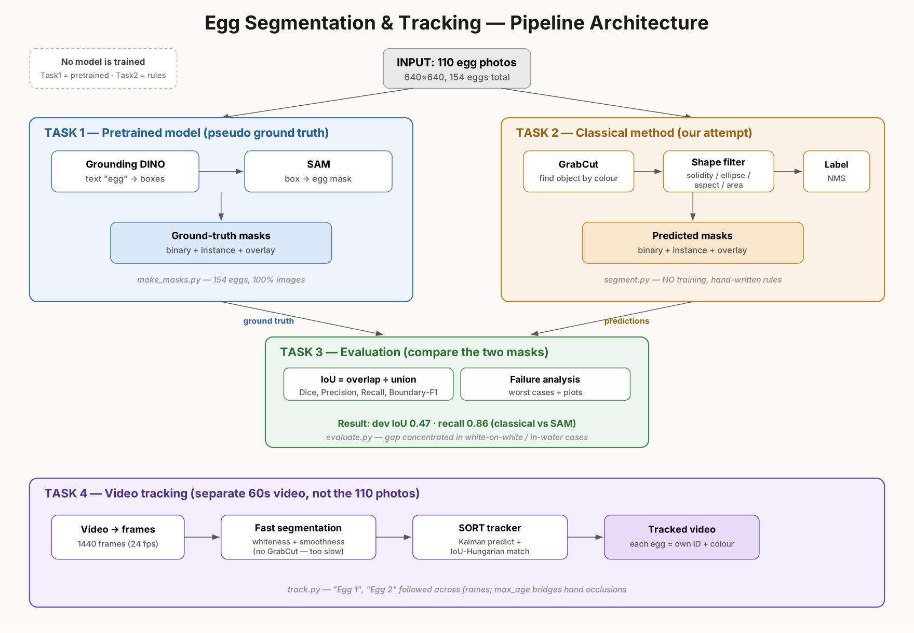

# Egg Segmentation & Tracking

Segment eggs in images with a pretrained model (SAM) and with classical image
processing, evaluate the gap between them, and track individual eggs in a video.



**Report:** [`report/report.pdf`](report/report.pdf) · **Tracking video (Task 4):**
[Google Drive](https://drive.google.com/file/d/1w-oOvS7VfZQYgPKBWkZ5NUsmYc5SKau6/view?usp=sharing)

---

## Results (summary)

| | IoU | Dice | Precision | Recall | Boundary-F1 |
|---|:---:|:----:|:---------:|:------:|:-----------:|
| Classical vs SAM — **dev** (88 img) | **0.473** | 0.589 | 0.531 | 0.857 | 0.340 |
| Classical vs SAM — **eval** (22 img) | 0.336 | 0.458 | 0.355 | 0.828 | 0.155 |

High recall, lower precision → the method **finds** eggs well but over-grabs
boundaries and over-segments on bright clutter. The gap vs SAM is concentrated in
white-egg-on-white-background and egg-in-water cases (see report).

---

## Setup (step by step)

**1. Clone and create an environment**
```bash
git clone https://github.com/<your-username>/<repo-name>.git
cd <repo-name>
python -m venv .venv
# Windows:  .venv\Scripts\activate
# Linux/Mac: source .venv/bin/activate
```

**2. Install PyTorch first** (pick the build for your machine):
```bash
# GPU (CUDA 12.1):
pip install torch torchvision --index-url https://download.pytorch.org/whl/cu121
# or CPU-only:
pip install torch torchvision --index-url https://download.pytorch.org/whl/cpu
```

**3. Install the rest**
```bash
pip install -r requirements.txt
```

**4. Add the dataset**: download the Roboflow "egg" dataset and extract it to
`data/egg_v1/` so that `data/egg_v1/{train,valid,test}` exist.

### Troubleshooting (Windows)
- **`ImportError: ComplexWarning`** → old scikit-learn vs NumPy 2.x: `pip install -U scikit-learn`.
- **Access violation / crash importing transformers** → two OpenCV packages clash.
  Keep only one: `pip uninstall -y opencv-python opencv-python-headless && pip install opencv-python`.
- **SQLite "disk I/O error"** on synced folders → `export_results.py` already writes to a temp dir then copies.

## Run

```bash
# Task 1 — SAM pseudo ground-truth (GPU recommended)
python task1_sam/make_masks.py --data data/egg_v1 --out outputs/task1

# Task 2 — leak-free split + classical segmentation
python task2_classical/split.py      --data data/egg_v1 --out outputs
python task2_classical/segment.py --data data/egg_v1 --out outputs/task2

# Task 3 — evaluation + plots
python task3_eval/evaluate.py --gt outputs/task1 --pred outputs/task2 \
       --split outputs/split.json --data data/egg_v1 --out outputs/task3

# Task 4 — download video + track
python -m yt_dlp --extractor-args "youtube:player_client=android" --no-part \
       -o "data/video.mp4" "https://www.youtube.com/watch?v=Y4JyV94y2_A"
python task4_tracking/track.py --video data/video.mp4 --out outputs/task4/tracked.mp4
```

### Extended analysis

These are not needed to reproduce the core results above; they provide the
supporting evidence discussed in the report (model-choice validation and a
queryable results database).

```bash
# Benchmark the ground-truth model: SAM-base vs SAM-huge vs FastSAM
python task1_sam/compare_models.py --data data/egg_v1 --meta outputs/task1/meta.json --out outputs/task1_compare --n 10
python task1_sam/compare_pulse.py --n 12            # per-image agreement pulse

# Export Task-3 results to SQLite + Excel (needs: pip install openpyxl)
python task3_eval/export_results.py --task3 outputs/task3 --out outputs
```

Findings (see `report/report.pdf`): SAM-base agrees 98.4% with SAM-huge, so base
was the right ground-truth choice. Classical IoU is driven by egg–background
contrast (Pearson r = 0.38, p < 0.001) and egg size — the quantified reason it
can't match SAM on white-on-white / in-water scenes.

## Repository layout

```
egg-seg/
├── data/egg_v1/              dataset (gitignored)
├── task1_sam/
│   ├── make_masks.py         Grounding-DINO + SAM  -> pseudo ground truth
│   ├── compare_models.py     model benchmark (SAM-base vs huge vs FastSAM)
│   └── compare_pulse.py      per-image model agreement
├── task2_classical/
│   ├── split.py              leak-free dev/eval split (pHash grouped)
│   ├── segment.py            the classical method (GrabCut + shape filter)
│   └── experiments.md        full trial log (v1 whiteness, v3 tighten, etc.)
├── task3_eval/
│   ├── evaluate.py           IoU/Dice/precision/recall/boundary-F1 + plots
│   └── export_results.py     results -> SQLite + Excel
├── task4_tracking/track.py   fast segmentation + SORT tracker
├── report/report.pdf         full write-up (all 4 tasks)
└── requirements.txt
```

## Method in one paragraph

**Task 1** uses *Grounded-SAM* (Grounding-DINO detects "egg" → SAM segments each
box) as pseudo ground truth. **Task 2** is a from-scratch classical pipeline:
*GrabCut seeded from the image border* locates the egg by colour contrast (not
brightness, because the egg is often darker than white backgrounds), then
solidity / ellipse-fit / aspect / area filters keep only egg-shaped blobs.
**Task 3** evaluates it against SAM and analyses where it fails. **Task 4** adapts
the segmenter for speed (whiteness + smoothness, no GrabCut) and adds a SORT
tracker (Kalman-style velocity prediction + IoU-Hungarian association) so each egg
keeps its own ID.

## AI tools disclosure

AI coding assistance (Claude) was used to help write and debug the scripts and to
accelerate the experiment loop. All methods are standard, well-understood computer
vision (GrabCut, morphology, contour shape descriptors, SORT); the design choices,
the experiment-driven method selection, and the analysis are explained in `report/report.pdf` and `task2_classical/experiments.md`.

Dataset: Roboflow Universe "egg" (CC BY 4.0). Tracking video: MocomiKids,
"Raw and Boiled Egg Spinning" (used for a technical demo).
